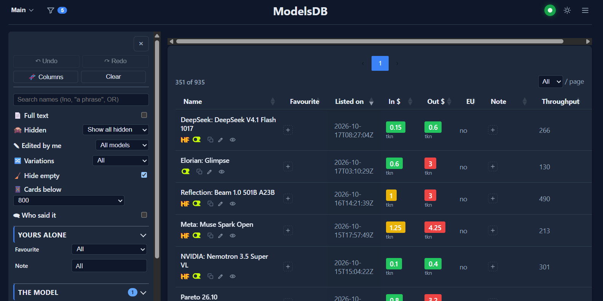
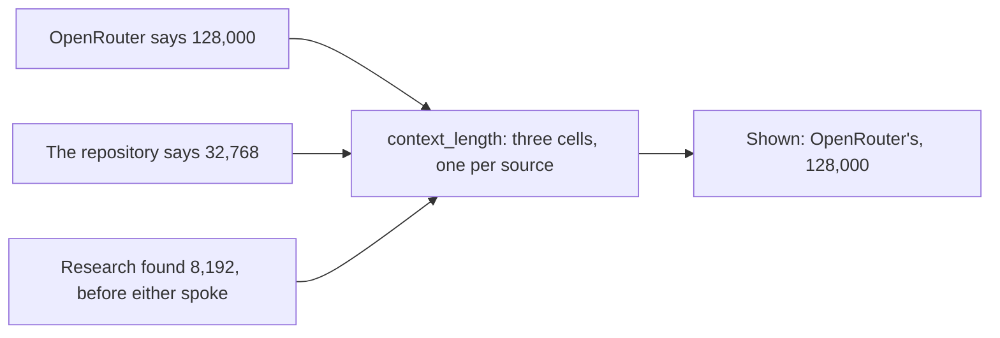

# ModelsDB

[](https://github.com/DavidTimar1/ModelsDB/actions/workflows/ci.yml)
[](https://github.com/DavidTimar1/ModelsDB/releases)
[](LICENSE)

A web application for browsing, rating and annotating AI models. It reads the live model list from OpenRouter, it can read a model's repository on HuggingFace, and it lets you write your own answers on top of both. It runs as a single self-contained Go binary that serves a local web page.



> **Coming from ModelsDB 1.29.0 or 1.30.1? This version is not backwards compatible.** It cannot open a database made by a 1.x version: it refuses it and changes nothing in it. Carrying an existing database into this version is a one-time manual job in a terminal, with a separate conversion download, and we recommend having an AI assistant (Claude, ChatGPT or similar) guide you through it, step by step, from [docs/migration.md](docs/migration.md). Copy your database first. A new install needs none of this.

## Contents

- [Background](#background)
- [Is this safe?](#is-this-safe)
- [Quick start](#quick-start)
- [Run from source](#run-from-source)
- [What is in the catalog](#what-is-in-the-catalog)
- [Adding, editing and removing models](#adding-editing-and-removing-models)
- [Columns](#columns)
- [Finding a model](#finding-a-model)
- [Updating the app itself](#updating-the-app-itself)
- [Where your data lives](#where-your-data-lives)
- [Backing up your data](#backing-up-your-data)
- [Query API](#query-api)
- [Building and releasing](#building-and-releasing)
- [More documents](#more-documents)
- [License and contributing](#license-and-contributing)

## Background

This is a hobby project. I built it because I could not find an easy way to track the AI-model tests I run for other projects, and to get a clear view of model costs and capabilities. I have limited time for it, but contributions are welcome.

## Is this safe?

Yes, by default. ModelsDB runs entirely on your machine. It has no accounts, no telemetry and no background service of its own. It reaches the network only to fetch the public model catalog from OpenRouter, to read a HuggingFace repository when you ask it to, and to ask GitHub whether a newer version of the app exists.

Do not take my word for it. Paste this repository into an AI and ask:

- [Ask Claude](https://claude.ai/new?q=Is%20https%3A//github.com/DavidTimar1/ModelsDB%20safe%2C%20will%20it%20spy%20on%20me%2C%20will%20it%20put%20malware%20or%20virus%20on%20my%20computer%2C%20why%20is%20my%20computer%20alerting%20me%20when%20I%20want%20to%20run%20the%20exe%20file%3F)
- [Ask ChatGPT](https://chatgpt.com/?q=Is%20https%3A//github.com/DavidTimar1/ModelsDB%20safe%2C%20will%20it%20spy%20on%20me%2C%20will%20it%20put%20malware%20or%20virus%20on%20my%20computer%2C%20why%20is%20my%20computer%20alerting%20me%20when%20I%20want%20to%20run%20the%20exe%20file%3F)

**Why does my computer warn me about the .exe?** The binary is not code-signed, because signing certificates cost money this hobby project does not spend. Windows SmartScreen and some antivirus tools flag any unsigned, less-common executable. You can read the source, build it yourself, or run it from source. To report a concern, see [docs/security.md](docs/security.md).

## Quick start

1. Download the latest binary from the [Releases page](https://github.com/DavidTimar1/ModelsDB/releases): `modelsdb.exe` for Windows, `modelsdb` for Linux.
2. Run it. On Windows, double-click `modelsdb.exe`. On Linux, `chmod +x modelsdb && ./modelsdb`.
3. Open `http://127.0.0.1:8122` in your browser.

The app starts empty and fills itself from OpenRouter: **Update models**, in the menu at the top right, stores every model OpenRouter lists and keeps what you already hold up to date. It runs every time the app starts too. A model new to your catalog arrives on the list, and the page says how many arrived.

Started in a terminal with no command, `modelsdb` shows a small menu: start in the background, stop, start in the foreground, status, update the models, add itself to your PATH. The same actions are commands, for scripts and services:

```bash
modelsdb start        # start the server in the background, then return
modelsdb stop         # stop the background server
modelsdb status       # is it running, and on which address?
modelsdb serve        # run in the foreground (what a service should call)
modelsdb update       # refresh the catalog without a server
modelsdb backup DIR   # copy your whole database into folder DIR
modelsdb backups      # list both kinds of backup
modelsdb restore FILE # roll the database back to a pre-migration snapshot (stop the server first)
modelsdb --help       # every command and flag
```

The menu appears only when you run it interactively; a service or a pipe starts the server directly. An unrecognized command is rejected rather than starting a server by accident. `restore` and `update` refuse to run while a server holds the data folder, whatever port that server listens on, and `backup` refuses only when a migration would have to run under that server.

## Run from source

With [Go 1.26 or newer](https://go.dev/dl/) installed, from the project root:

```bash
go run ./cmd/modelsdb
```

Run that way, the app keeps its data under `./data` instead of your user folders. `bash build.sh` writes a shippable `dist/modelsdb.exe` and `dist/modelsdb`.

## What is in the catalog

**One model is one row, and everything known about it is a cell in a column.** A column is the plain name of the fact it answers, `context_length`, `parameters`, `notes`, and there is exactly one column per fact whoever filled it in.

**Who said a value is recorded on the value.** Every cell carries its source: `openrouter`, `huggingface`, `research` (a value found to fill a gap: by an assistant through the API, or by you, in **Add model**, for a model that is brand new to your catalog), `hand` (you, in your own columns), or `app` (the one fact only the app can state, the date a model entered your catalog).

**There are two kinds of column, and the line between them is who writes.** A column OpenRouter states, a repository measures or the app works out is never typed over: an update maintains it, and the page never offers to type into it, whether it holds a value or is empty. Where such a cell is empty it stays that way until OpenRouter or the repository states it, or until it is answered as research - through **Add model**, for a new row, or over the API. Your own columns - the note, the favourite, and every column you make - are written by nobody but you, and no update ever touches them. The **Columns** dialog says which kind every column is.

**Two sources that disagree keep both answers.** If OpenRouter says a model takes 32,768 tokens of context and its repository says 128,000, both are stored as two cells of the one column. The table shows the answer from the source the column prefers, an order fixed in the app: OpenRouter for what OpenRouter serves, the repository for what it measures. A researched value ranks below both.



A cell says who answered it with a small mark where it matters: a filled dot for your own answer in a column of yours, the source's name where several could have answered, the word Research on a researched value, a red mark where OpenRouter and the repository disagree. Press any of them to see every source's answer and when it was given.

**A model's type says what it produces.** OpenRouter's own output list decides it: chat unless the model gives out images, video, embeddings, reranking scores, speech, transcription or music, and `decisions` for a model whose output is a score for each allowed option instead of text. The next **Update models** corrects the type of rows an earlier version filed as chat.

A fresh install draws a short default set of columns and holds many more behind the **Columns** button. **Added** is one of the hidden ones: the date a model first entered your catalog, stamped once and never rewritten, which is a different date from **Listed on**. You can add columns of your own, which nothing but you ever fills in.

## Adding, editing and removing models

Everything OpenRouter lists arrives on its own. **Add model**, in the menu, covers the rest in two ways: **from a HuggingFace address**, where the server reads the repository itself and records what it states, nothing typed, except how the model is built: that **Architecture** line is written afterwards from the repository's `config.json`, by you or by an assistant following the update procedure; or a **custom model** you fill in by hand. A model already in your catalog can be re-imported from its **Details** dialog, which names what will be rewritten before it sends anything and never touches your note, your star or your own columns.

**A cell can be edited where a source has not already spoken and never where nothing has spoken at all**, in the cell itself or in the row's own form behind the pencil: a column of yours always, and a fetched, measured or worked-out cell only once it already holds a value found by research. An empty one of those stays read-only on the page too, until a source fills it or, for a new row, **Add model** does. `Ctrl`+`Z` undoes single-cell edits while the tab is open.

**Every row carries an eye** that hides the model, and a hidden row carries a crossed-out eye that puts it back. Hiding throws nothing away. **A model OpenRouter lists cannot be deleted**, because the next update would store it again, so its row has no delete control; hide it instead. A row you typed in or imported from HuggingFace can be deleted outright, and that is final: your note, your star and every value you wrote about it go with the row, so the app names what goes before it asks.

**Variations** are downloadable builds of a model. The download icon in the **Var** column records one from its HuggingFace repository, or files a model you already have under this one. ModelsDB downloads nothing: it records where the file is, how big it is and how it is stored. A build is drawn under its parent, tinted as a group, and a mark on its row takes it back out if it was filed under the wrong model.

**Handing the research to an AI assistant is optional.** A **Copy agent brief** button, in the import result and in each model's Details dialog, copies instructions naming that model, the facts it still has no answer for that can apply to that kind of model, and this instance's addresses, so an assistant can look the facts up and post them back.

## Columns

The **Columns** button in the filter panel lists every column with its key beside it. Tick one to draw it. **Rename** changes only the heading; every value follows, because a value names its column by key. **Colours** shades a column's cells by threshold, by yes or no, or by label; the two price columns ship coloured. **Delete** is offered only for a column of your own and removes every model's value for it. **Make a column of your own** takes a heading and a kind of value. Every field the OpenRouter feed carries is already a column: the refresh makes one for each field no shipped column reads, hidden until you tick it, and you can find it by the feed's own name for it as well as by its heading.

## Finding a model

The funnel at the top left opens the filter panel. It builds one control per visible column out of what that column holds: a figure for a number (at most this much for a price), yes, no or empty for a flag, a value list with include and exclude for anything with a fixed set of values (its first row, **Empty**, is the models with no value), a text box otherwise. A **Links** filter in the Where it lives group keeps the models that have an OpenRouter or a HuggingFace link. Beside them sit the search over the model's name (every word must appear, in any order; `"a phrase"`, `!word` to leave a word out, `AND` and `OR` in capitals; the text boxes and value-list searches read the same way), **Hidden**, **Edited by me**, **Variations** and **Hide empty**, which takes out the columns nothing on show has a value in.

**Every filter you set appears in the address bar**, in the same words the API takes, so the address is always a link to these rows. Your column layout stays out of it, because that belongs to your computer.

## Updating the app itself

When a newer release exists a banner appears. **Update now** downloads the new binary, verifies it against a signed checksums file and swaps it in beside the running one; **Restart to apply** re-launches into it. The app never restarts on its own. **Automatically download updates**, in the **Info** dialog, downloads and verifies in the background so the banner is ready; restarting is still your click. On a platform with no published asset the banner is a plain download link.

## Where your data lives

| Kind | What | Default |
|---|---|---|
| **config** | `config.jsonc` | `%APPDATA%\modelsdb`, `~/.config/modelsdb` |
| **data** | `modelsdb.db` with its `-wal` and `-shm` sidecars, and `.backups/` | `%LOCALAPPDATA%\modelsdb\data`, `~/.local/share/modelsdb`, `~/Library/Application Support/modelsdb` |
| **cache** | `logs/`, `modelsdb.pid`, `update-check.json`, `backup-schedule.json`, `model-update.json` | the OS cache directory, under `modelsdb` |

To put them somewhere specific, drop a `config.jsonc` next to the binary. `{"portable": true}` keeps everything in the binary's own folder. Or name each folder, the port and the bind address:

```jsonc
{
  "data_dir": ".",            // or an absolute path; omit a field for the OS default
  "cache_dir": ".",
  "port": 8122,
  "host": "127.0.0.1",        // extra bind address; "tailscale" binds this machine's 100.x address
  "allow_public": false,      // required to bind 0.0.0.0 or a public address
  "upstream": { "owner": "DavidTimar1", "repo": "ModelsDB", "branch": "main" }
}
```

The app writes a commented template the first time it runs. The `upstream` block is the fork switch: point it at your own fork and the app checks that repository for releases. Flags and environment variables override the file; `internal/paths/paths.go` is the full order.

**The server answers only to names it knows.** A request whose `Host` is not `localhost`, a loopback address, an address the server bound or the host of an `allowed_origins` entry gets 403. This stops a hostile web page from reaching the server through DNS rebinding. Add an `allowed_origins` entry (a full address such as `https://models.example`) when you reach the app by a machine name, or through a reverse proxy, that the server did not bind itself.

**There is no authentication.** Anyone who can reach a non-loopback address you bind gets full read and write, including the routes that destroy data and the one that replaces the program. The server refuses a public or `0.0.0.0` bind unless you pass `--allow-public`. Prefer a private address, such as `"host": "tailscale"`.

## Backing up your data

Everything is in one file, `modelsdb.db`, in the data folder. That is the only copy, and backing it up is the only protection you have.

```bash
modelsdb backup /path/to/your/backup/folder
```

That writes one dated `.db` file, complete on its own, and touches nothing else in the folder. It only reads your database, so you can take one while the app is running. To put one back, stop the app, delete `modelsdb.db-wal` and `modelsdb.db-shm` from the data folder, then rename the backup to `modelsdb.db` there. A stopped app can leave those two files behind, and a backup placed beside them opens as a damaged database.

**If you copy files by hand, copy three together**: `modelsdb.db`, `modelsdb.db-wal` and `modelsdb.db-shm`. The database writes its newest changes into the `-wal` sidecar first, so the main file alone is behind and can be missing whole batches, and the trap is that such a copy still opens perfectly. `modelsdb backup` avoids this entirely.

**Automatic daily backups** are opt-in, in the **Info** dialog: tick the option, name a folder, and once a day the app writes a backup there when the database has changed. `modelsdb backups` and `modelsdb restore` are a different thing: the snapshots the app takes automatically before it changes the shape of the database, kept in its own `.backups` folder and pruned. The backups you take are never deleted by the app.

**The model catalog updates itself once a day** while the app runs. The switch is in the **Info** dialog, under "Daily model update", and it is on until you untick it. It runs the same update as **Update models** but slowly, a request about every second, so it takes around 25 minutes; it shows nothing while it runs, and afterwards an open page offers a **Refresh** button; a failed update is shown in a bar and in the Info dialog, and is tried again within the hour. The app also updates once at every start, and a daily run is due a day after the last update of any kind.

**Upgrading from a 10.x version** needs nothing from you: the new binary carries your database forward, taking a snapshot first and restoring it if anything fails. **A database from ModelsDB 1.29.0 or 1.30.1 is not carried forward automatically**: this version refuses it unchanged, and [docs/migration.md](docs/migration.md) says how to convert it once, by hand, preferably with an AI assistant guiding you.

## Query API

The server runs on a fixed port so other local apps and agents can query the catalog over HTTP. **`GET /api` is the reference**: a markdown guide, written for an agent or any caller, documenting every route and every rule a write obeys, and a test fails if a route is missing from it. The short version:

```bash
# Every column: key, heading, kind of value, and the sources that can answer it.
curl 'http://127.0.0.1:8122/api/columns'

# The catalog. Filters name a column by key: exactly this, min:, max:, contains:.
curl 'http://127.0.0.1:8122/api/models?context_length=min:200000&fields=name'

# Writing: values are text. A column of yours takes it as yours; an empty fetched cell takes it as research over this API (the page never offers to); a fetched cell a source has stated refuses it.
curl -X POST http://127.0.0.1:8122/api/save \
  -H 'Content-Type: application/json' \
  -d '[{"name":"OpenAI: GPT-5","cells":{"notes":"handles long diffs well"}}]'
```

A read and a write speak one set of names, so a value read out can be posted straight back. An unknown parameter or key answers 400 and names it; nothing is silently ignored. `GET /api/guide/update-database-manually` serves the procedure for researching a model's missing data by hand.

## Building and releasing

`bash build.sh` produces `dist/modelsdb.exe` and `dist/modelsdb`.

Releases are built by GitHub Actions when a `v*` tag matching `VERSION` is pushed, and are signed on the maintainer's own machine, so no signing key exists in GitHub. The in-app self-update trusts a download only when the release's `SHA256SUMS` file is signed with the key whose public half is in `internal/selfupdate/pubkey.go`. That file also names the release version, and the app refuses a version that is not newer than the running one.

1. Push the tag. The workflow builds a **draft** release holding the two binaries and `SHA256SUMS`. A draft is invisible to the app.
2. Check the workflow run, then sign and publish on your own machine, logged in with `gh`: `go run ./cmd/sign publish -tag vX.Y.Z -commit <full commit hash> -key <your key file>`, where the hash is the commit the tag points at on GitHub. Publish rebuilds that commit in a sandbox and signs only when the binaries are identical to the draft's, so a binary CI built from anything else is never signed. It runs on Linux with `bubblewrap` installed, because it compiles the commit's code and that code must not see the key. The header of `cmd/sign/main.go` says what it checks. The rebuild gives the same bytes only with the same Go toolchain CI used; `go.mod` pins it with a `toolchain` line, so check `go version` against that line if the hashes differ.
3. A fork that wants working self-update makes its own key once with `go run ./cmd/sign keygen -seed-out <file outside any git work tree>`. The private seed goes to that file and is never printed. The file is plain text protected only by its mode (0600), with no passphrase, so keep a copy offline: whoever reads it can sign updates for every install, and losing it with no copy means every install must be downloaded by hand again; paste the printed public key into `internal/selfupdate/pubkey.go`.

An install built with an older signing key can no longer verify updates and must be downloaded by hand once.

## More documents

- [docs/architecture.md](docs/architecture.md), how the data is stored, who may write what, and where the code for each part lives.
- [docs/design.md](docs/design.md), what the page is made of and the choices that shape it.
- [docs/migration.md](docs/migration.md), converting a database from ModelsDB 1.29.0 or 1.30.1 to this version, once.
- [docs/security.md](docs/security.md), what the app reaches and how to report a problem.
- [docs/contributing.md](docs/contributing.md), how to contribute.

The code is the truth. These are overviews, and `GET /api` on a running server is the API reference.

## License and contributing

Licensed under the [MIT License](LICENSE). Contributions are welcome: see [docs/contributing.md](docs/contributing.md).
