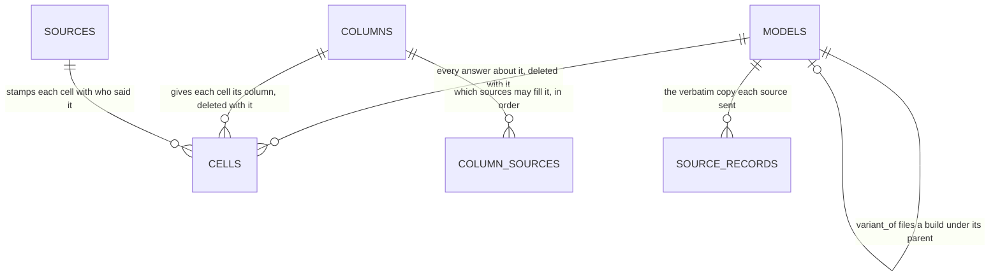
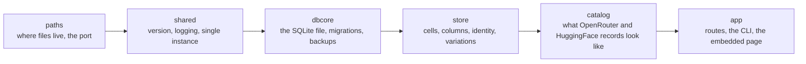

# How ModelsDB is built

An overview of the back end for somebody who has never seen the project: what the data looks like, who may write what, and where the code for each part lives. It is deliberately short. The code is the truth, and this document points at it rather than restating it.

The page is [design.md](design.md). Installing and using the app is the [README](../README.md).

## Contents

- [The problem, and the one idea that solves it](#the-problem-and-the-one-idea-that-solves-it)
- [Words used here](#words-used-here)
- [The shape of the data](#the-shape-of-the-data)
- [Who may write what](#who-may-write-what)
- [Which answer is shown](#which-answer-is-shown)
- [How the code is laid out](#how-the-code-is-laid-out)
- [How a model gets in](#how-a-model-gets-in)
- [Renames and duplicate rows](#renames-and-duplicate-rows)
- [Reading a HuggingFace repository](#reading-a-huggingface-repository)
- [The HTTP surface](#the-http-surface)
- [Files, the port, and starting up](#files-the-port-and-starting-up)
- [Changing the shape of the database](#changing-the-shape-of-the-database)
- [What it does not do](#what-it-does-not-do)

## The problem, and the one idea that solves it

ModelsDB is a local catalog of AI models: one row per model, one column per question you can ask about one. It reads OpenRouter's public model list, it can read a model's repository on HuggingFace, and it lets the person running it keep columns of their own beside what those sources state.

Several places describe the same model and they disagree. OpenRouter says a model takes 32,768 tokens of context; the model's own repository says 128,000. The usual answer is one column per fact plus a rule for who may overwrite whom. ModelsDB does the other thing: **it keeps every source's answer as a cell of its own, stamped with who said it, and decides which one to show when the row is read.** There are two kinds of column, and the line between them is who writes: a column an automatic source states is never typed over, and a column of the reader's own is never touched by an update. A value found to fill a gap no source has stated is a source of its own, research, ranked below the automatic ones so that the day a source states the fact, that is what shows.

## Words used here

- **Model.** One row of `models`, keyed by its display name. The row holds identity and nothing else.
- **Column.** One question that can be asked about a model. A row of `columns` with a permanent key, the plain name of the fact (`context_length`), a heading, a kind of value and colour rules.
- **Cell.** One source's answer for one model in one column. A row of `cells`. Every fact about a model is one.
- **Source.** Who stated a value: `openrouter`, `huggingface`, `research` (a value found to fill a gap, by the reader in the page or by an assistant through the API), `hand` (the reader, in a column of their own), `app` (the program).
- **Kind.** What a column is, read off who declares it: fetched, measured or derived (an automatic source states it, research may fill a gap), stamped (the app writes it once), or yours (the reader alone writes it). `GET /api/columns` says which.
- **Rank.** A column's preference between its sources, one row of `column_sources` per source it accepts. It is fixed in the code: OpenRouter first where OpenRouter serves the fact, the repository first where it is read for it, `research` last, `hand` alone.
- **Sealed column.** One the app ships. It can be relabelled, moved and hidden, never deleted or re-typed.
- **Variation.** One quantized build of a model, recorded as a row of its own and filed under the model it was built from by `variant_of`.

## The shape of the data

Three things about it are worth knowing before anything else:

- **The primary key of `cells` is `(column_id, model_name, source)`.** Two sources answering the same question about the same model are two rows that cannot collide. That key is the whole write guarantee.
- **A cell with no value has no row.** Clearing a cell is how you ask for a source's answer back.
- **Deleting a model or a column cascades away every cell on it**, and the database file is their only copy.

The floor schema a new database starts from is `schemaSQL` in `internal/dbcore/db.go`; what a current database holds is that plus every migration in `internal/dbcore/migrate.go`. A full generated reference of the live schema can be produced by `TestGenerateArchitectureDocs` in `internal/store/archdocs_gen_test.go` into a folder you name; it is not committed.

## Who may write what

One statement, in `internal/store/cells.go`, inserts, updates or deletes a cell, and two functions reach it. `store.WriteCells` is the entry for the automatic sources and the app's own stamp: every caller declares which source it writes as, using a defined Go type rather than a string off the wire. `store.SaveCells` in `internal/store/savecells.go` is the entry for what a person or an assistant sends, and it decides the source per key from the column and from what is on file for that model. A source the column does not accept is refused in Go and again by a database trigger.

| Writer | Writes as | Where |
|---|---|---|
| The OpenRouter refresh, and the facts the app works out from it | `openrouter` | `internal/catalog/update.go` |
| A HuggingFace import, and the build importer | `huggingface` | `internal/app/importhf.go`, `internal/store/variations.go` |
| A person or an agent over HTTP, and the page's Add model form for a brand-new row, into an empty fetched cell | `research` | `internal/store/savecells.go` |
| The same, into a column of the reader's own | `hand` | `internal/store/savecells.go` |
| The stamp saying when a model entered this catalog | `app` | `internal/store/added.go` |

A save onto a fetched cell an automatic source has already stated is refused, naming the source and its value. `added` is the one column nothing typed can reach at all: only the app states it, once, at insertion.

## Which answer is shown

The rank order is code, not stored data: `shippedColumns` in `internal/store/shipped.go` is the one place a column's sources and their order are written, and `store.DeclareShippedSources` reapplies them to `column_sources` at every start, so no route changes them and a change to them needs no migration. A read picks the winning cell as the query runs, through the `answers` view, so nothing is computed into storage and nothing goes stale. Every row from `GET /api/models` also says which source answered each cell and which cells OpenRouter and the repository disagree on; `GET /api/models/{name}/answers/{column}` lists every source's answer for one cell with the date it was written.

## How the code is laid out

The packages under `internal/` form a strict import chain. Nothing points backwards.

Where a new piece of code goes: knowledge of an upstream record's SHAPE goes in `catalog` and nowhere else; how a value is stored or typed goes in `store`; a request or a command goes in `app`.

| What | Where |
|---|---|
| The floor schema | `internal/dbcore/db.go` |
| Every migration, and the schema version | `internal/dbcore/migrate.go` |
| The one cell writer, and the sources | `internal/store/cells.go`, `internal/store/source.go` |
| The columns the app ships | `internal/store/shipped.go` |
| What a save may name, the rule that decides the source per key, and every refusal | `internal/store/savecells.go` |
| The OpenRouter record's shape, and the refresh | `internal/catalog/update.go` |
| Every route, in one list | `internal/app/server.go` |
| The served API guide | `internal/app/query.go` |
| The page | `internal/app/index.html`, `internal/app/static/` |

## How a model gets in

The app ships no catalog. **The refresh** (`POST /api/update`, `modelsdb update`, and the fetch every start runs) stores every model the OpenRouter feed lists, creating a visible row for each one the catalog does not hold, and reports how many it created. Everything else arrives by hand: `POST /api/models/import` reads a HuggingFace repository into a row, `POST /api/models/add` is a row the reader types, and `POST /api/models/variations` records a build under its parent.

**The refresh also runs once a day, on a timer.** `internal/app/modelupdate.go` is why and how: a server that stays up for weeks would otherwise serve a catalog as old as its last start. It wakes hourly, asks a pure question (`modelUpdateDue`) of the record of the last finished run, and starts the same single-flight refresh the button uses, so a button press during a scheduled run gets the 409. The switch is the `daily_model_update` row of `app_settings`, ON until stored as false. The record of the last run (outcome, the passes that failed, a run counter) is a cache-dir file, `model-update.json`, because it is a fact about this machine and holds no model data; the page reads it from `GET /api/update/status` to learn of a run it did not start, and a scheduled run is silent by design. `catalog.FetchModelsWith` returns the passes that failed (`catalog.Report`), because every pass after the feed fails soft and would otherwise only reach the log. **Only the scheduled run is paced** (`scheduledRunOptions`, `catalog.Options.Paced`): nobody waits on it, so its per-model passes and bulk requests go one at a time about a second apart (`internal/catalog/pacing.go`), where the button and the start-up update keep eight at a time. Every run, paced or not, waits and sends a request again when OpenRouter answers 429 or 503 (`getWithRetry`: its `Retry-After`, else 2 s doubling, never over 60 s, five retries), and a request still refused counts as failed toward the half-of-requests rule. The `testhooks` build tag (`internal/app/modelupdate_testhooks.go`) is how a browser test shortens the clocks and points the feed at a local server; a release binary does not contain it.

Two consequences follow from "the refresh pulls the whole feed". A row the feed carries is an OpenRouter row from then on, whichever route first created it, and such a row can be hidden but not deleted, because the next refresh would create it again. And a model the feed stops listing keeps its row and everything on it; nothing removes a row on its own.

The refresh also makes the columns. Every leaf path the feed carries that no shipped column reads becomes a column on the refresh that first sees a value there, keyed by the whole path, hidden until ticked, and sealed like a shipped column because the next refresh would make it again. It is filled in that same refresh. Which paths a shipped column already reads is `feedPathColumns` in `internal/catalog/feedcolumnmapping.go`; the making is `store.CreateFeedFieldColumn` in `internal/store/feedfields.go`.

**The refresh reads three listings as one feed.** The general listing carries none of a video or an image model's own fields, so the video and image listings are read too and each record is joined onto the row the general listing made in the same refresh, by OpenRouter's id, never minting a row of its own (`internal/catalog/dedicatedlistings.go`). A flat object whose keys differ per model, and a list of objects, are each ONE list column at their own path, because splitting them across columns would pair one entry's value with another's (`walkFeedValue` in `internal/catalog/feedfields.go`).

**Two columns come from OpenRouter's frontend, not its public API.** ZDR (`internal/catalog/zdr.go`) and Throughput (`internal/catalog/throughput.go`) are worked out from unofficial per-model feeds, because the public endpoints answer null for the speed. Both run after the main feed with the same bounded worker pool, and both fail soft: a model whose call fails keeps its value, and the refresh never fails because of either. Throughput is the highest median speed across a model's measured providers, and a model with none has its cell cleared rather than left stale.

**EU is one request to OpenRouter's public API.** `internal/catalog/eurouting.go` reads the model list OpenRouter filters to its EU address and marks every OpenRouter row of the refresh yes or no. It is its own pass because that list is the only place the fact is stated. It checks the answer before writing anything: OpenRouter ignores a query parameter it does not know and then answers the whole feed, which would mark every model yes. A failed or implausible answer writes nothing and clears nothing.

The Type column is worked out from the feed's output list on every refresh, so a new kind of output is one more line in `outputTypes` in `internal/store/store.go`; a model that gives out a score for each allowed option is typed `decisions`.

The refresh fails soft everywhere: a fetch that cannot finish leaves the server up and the catalog as it was, and one unusable value or one column that cannot be made costs only itself.

## Renames and duplicate rows

OpenRouter keeps a model's `id` when it renames the model, so the id, not the display name, says two rows are one model. Before it upserts a feed record the refresh asks `store.ReconcileRenamedModel` (`internal/store/reconcile.go`), among rows whose `models.source` is `openrouter` only: a row holding the record's id under another name is renamed to the feed's name, or, when the feed's name already has a row of its own holding the same id, folded into it. A row from any other route is never renamed or merged, because its identity is not OpenRouter's.

Why a merge never loses what the owner wrote: a hand answer, a research answer, a HuggingFace cell, `added` (the older date wins) and the verbatim records of other sources move to the surviving row, and only the stale row's OpenRouter cells go, because the refresh restates them. Two rows holding different hand answers for one column are not merged and the refresh logs a warning naming the id and column. A feed name that belongs to a row with another id changes nothing and logs a warning. The old name stops answering at `/api/models/{name}`; there is no alias.

The first rename or merge of a refresh writes a snapshot into `<data>/.backups/` (`dbcore.SnapshotBeforeRewrite`, the migration mechanism); a refresh with nothing to follow writes none. If the snapshot cannot be written the refresh stops with an error rather than change a row unprotected. The write itself is a transaction of insert-new-row, repoint `cells` and `source_records`, delete-old-row, because `models.name` is a foreign key target with no `ON UPDATE`.

## Reading a HuggingFace repository

`POST /api/models/import` takes a repository address and nothing else. Every value the import writes was read off HuggingFace at that moment, never typed from memory, which is what makes its figures measurements. How the model is built is not written by the import: the Architecture line is filled afterwards from the repository's `config.json`, by the reader or by an assistant following the update procedure. A gated repository is refused rather than half-imported. Whether the model is already in the catalog is decided by `store.FindExistingModel`, which asks about the repository first, then the OpenRouter identifier, then the name, and stops at the first answer.

A build is recorded the same way, by re-reading the repository, and filed under its parent with `variant_of`. Filing is reversible through `POST /api/models/variations/unfile`, the only thing that ever clears that column.

## The HTTP surface

Every route is registered once, in `serverRoutes` in `internal/app/server.go`, and the served guide at `GET /api` has a heading for each. A test fails when a route has no heading, so the guide cannot fall behind the routes. That guide, not this document, is the reference for what each route takes and returns.

Two rules shape every write. Every value is text, read and written under the same column keys, so a value read out can be posted straight back. And an unknown key or parameter answers 400 and names it, because a filter the server silently dropped would answer with the whole catalog while looking like a narrow answer.

## Files, the port, and starting up

Config, data and cache resolve independently: a flag, then an environment variable, then a `config.jsonc` next to the binary, then one in the OS config directory, then the OS default. `internal/paths/paths.go` is the cascade. The port is fixed and never discovered, and a public or wildcard bind is refused unless explicitly allowed, because there is no authentication.

On start the port is bound BEFORE the database is opened, and every request gets a short 503 until the catalog is ready. The port is what a second instance reads to decide whether this data directory is taken, so holding the database without the port would let two processes open one file.

## Changing the shape of the database

The schema version lives in SQLite's `user_version`. On open, every migration above the file's version runs in order, each in a transaction, after a snapshot into `<data>/.backups/`, with an integrity check afterwards and an automatic restore on failure. A database below the floor version is refused without being opened for writing; [migration.md](migration.md) is what its owner follows. To change the schema, bump `schemaVersion` by one and append a migration; never hand-edit the floor.

The pre-migration snapshot is made with SQLite's `VACUUM INTO`, so it holds the newest writes even while they are still in the write-ahead log. The user-facing backup, `modelsdb backup <dir>`, uses the same call but is a separate mechanism: one self-contained file, only ever reading the live database, and never pruned by the app.

## What it does not do

- Nothing is computed from other columns. Every value was stated by one source.
- A cell keeps no history. A new value replaces the old one.
- No request renames a model or a column key; only a heading changes. The refresh is the one exception for models: see [Renames](#renames-and-duplicate-rows).
- There is no authentication at any address.
- Two rows for one model that share no identifier are not detected.
- Nothing removes a row on its own.
