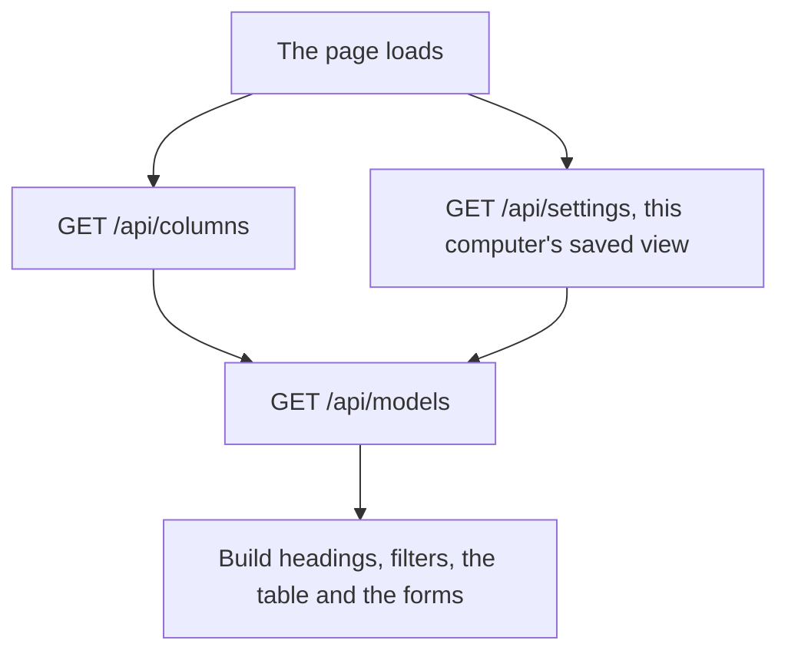

# How the page is built

An overview of the interface for somebody who has never seen it: what it is made of, the few choices that shape everything else, and where it stops. The page itself and its code are the truth; this document points at them.

How the data is stored and served is [architecture.md](architecture.md). Using the app is the [README](../README.md).

## Contents

- [The one idea](#the-one-idea)
- [What it is made of](#what-it-is-made-of)
- [The table](#the-table)
- [Editing](#editing)
- [Finding rows](#finding-rows)
- [Dialogs and messages](#dialogs-and-messages)
- [What it does not do](#what-it-does-not-do)

## The one idea

ModelsDB is a big spreadsheet with a good table on top: one row per model, one column per question. **The columns are not known in advance.** Which exist depends on what OpenRouter states, what a repository states, and which columns the reader invented. So the page holds no list of fields at all. It asks the server which columns exist and builds the headings, the filter panel, the editors and the row forms out of the answer. A column added on the server, or invented in the browser, changes the page without a line of JavaScript being touched.

## What it is made of

| Piece | Where | Why |
|---|---|---|
| One HTML file | `internal/app/index.html` | One page, no router, no framework, no build step to get wrong |
| jQuery and DataTables | `internal/app/static/` | The table is the product; sorting, paging and column visibility are DataTables' job |
| One JavaScript file | `internal/app/static/app.js` | Served as written, no bundler, no `node_modules` at runtime |
| One stylesheet | `internal/app/static/style.css` | Custom properties for the theme, no CSS framework |
| Everything embedded in the binary | Go's `//go:embed` | The app is one file you can copy anywhere |

Two consequences for anyone working on it. A running server keeps serving the files it started with, so **restart it before judging any change to `index.html` or `static/`**. And there is no JavaScript test runner: a change here is verified by driving it in a browser and saying what was clicked.

## The table

Every row is a model and every cell is a column's value on it. Two columns are the page's own: **Name** on the left carries the name, its description on hover, the listing date, the links and the row's controls; **Var** on the right carries the variation count and the control that adds one. Everything between is a real column, in the order the reader has arranged.

The controls on a row say what the row is. An eye, visible without hovering, hides the row or puts it back. A delete control is drawn only on a row that can be deleted, which is one OpenRouter does not list; drawing it and then refusing would teach the reader that the app says no at random. A row filed under another model carries the way back out.

A cell can carry a small mark saying who answered it: a filled dot for the reader's own answer in a column of theirs, the source's name on every other filled cell, the word Research on a value found to fill a gap, a red mark where OpenRouter and the repository disagree. Pressing any of them lists every source's answer and when it was given. The marks are off unless the filter panel's Who said it tick is on; the red mark stays whatever the tick says.

A variation is drawn as a child row under its parent so it follows the parent through every sort and filter. Below the width the reader sets with the filter panel's Cards below control (1642 pixels by default, or never) the table becomes cards, one per model. The heading row stays pinned while the page scrolls, and on a wide screen the Name column is frozen so a value always sits beside the name it belongs to.

In the table the Name cell's second line is full. Adding a mark there needs the line redesigned, and the stylesheet says so beside the rule. On a card the marks are not a row: they follow the date as plain inline items and wrap one by one at the line end.

## Editing

Click a cell, or press Enter on it, and it becomes a control matching the column's kind of value where a source has already spoken there: a column of the reader's own always, and a fetched, measured or worked-out cell only where it already holds a researched value. Anywhere else - a cell an automatic source has stated, or one nothing has stated at all - it says whose answer it holds, or that nothing has, when pressed, and stays a plain cell otherwise; `added` behaves the same way, always. The row is read back afterwards rather than patched in place, because which answer a cell shows is decided on the server. Undo and redo cover single-cell edits for as long as the tab is open.

## Finding rows

The filter panel on the left builds one control per column whose Filter tick is on out of what that column holds: a figure for a number (each price column also carries its own Hide 0 tick), yes, no or empty for a flag, a value list for anything with a fixed set of values (its first row, Empty, is the models holding nothing in that column, so the models a filter would otherwise hide are one click away), a From and To day picker for a date, a text box otherwise. The Links filter is the one control that is not a column: it keeps the models that have an OpenRouter link, a HuggingFace link, or either, and travels as the `links` parameter because "either" looks at two columns at once. A column's Filter tick in the Columns dialog is separate from its Table tick, so a column can leave the table and keep filtering; a filter applies exactly when its control is in the panel. Every filter names a column by its key and is answered by the server, so the page cannot drift from the API. **The address bar is the view**: every filter set appears in it in the same words the API takes, so the address is at all times a link to these rows. The column layout stays out of the address, because it belongs to this computer rather than to the rows a link points at.

## Dialogs and messages

Every dialog holding a form is a native `<dialog>` opened with `showModal()`, which makes the page behind it inert and closes it on Escape. One toast at the top of the page says what happened, mirrored to screen-reader regions, and a dialog never uses it because a native dialog renders above it. What an update added is a bar with an action rather than a toast, because the number names rows the reader would otherwise have no way to find.

A second, smaller pill sits just under that toast: it says what a filter change just did to the row count, one sentence, replacing itself (never stacking) on the next change and clearing itself a few seconds later. It is neutral, never colour-coded like the toast, because a filter narrowing the table is not a failure.

The theme is applied before any CSS paints, by a tiny script in the head, so the page never flashes the wrong theme. Colour carries meaning in two places only: a column's own colour rule, and the tint grouping a model with its variations.

## What it does not do

- It decides nothing about a value. Which of several answers a row shows is worked out on the server.
- It cannot rename a model.
- It has no undo for a deleted model, a deleted column or the row form.
- It has no automated tests. Changes are verified in a browser.
- It is one page, with no routing and no state that survives a reload beyond what the server has stored and what is in the address.
